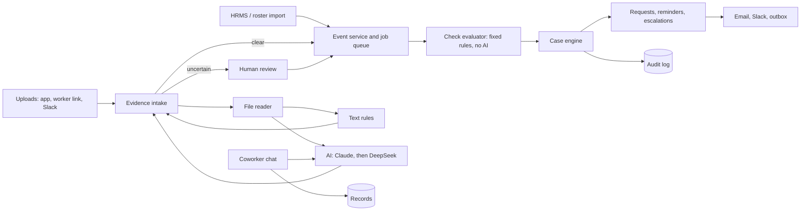

# Aegis: AI Compliance Coworker

Aegis keeps a workforce compliant without a person chasing every document. It holds each worker's record, checks it against compliance packs (healthcare credentials, onboarding, immigration, payroll), opens a case when something is missing or expiring, asks the right person for the document, reads what comes back, and closes the case once the check passes. Every step is recorded in a tamper-evident audit log.

The AI reads documents and understands chat questions. It never decides compliance: checks are fixed rules, and anything uncertain goes to a person.

**Status:** MVP, being prepared for the Bluebix healthcare-staffing pilot.

## Contents

- [What it does](#what-it-does)
- [Tech stack](#tech-stack)
- [Architecture](#architecture)
- [Getting started](#getting-started)
- [Configuration](#configuration)
- [Project structure](#project-structure)
- [Evidence reading](#evidence-reading)
- [AI providers](#ai-providers)
- [Testing](#testing)
- [Walk through the workflow](#walk-through-the-workflow)
- [Deploying the Bluebix pilot](#deploying-the-bluebix-pilot)
- [Operations](#operations)
- [Further documentation](#further-documentation)

## What it does

- **Checks** every worker against the active compliance packs, every day and whenever something changes.
- **Cases** open for each gap, with a due date, an owner, reminders and escalation.
- **Requests** go to the worker by secure upload link, email or Slack, sent once and followed up.
- **Evidence** is read from almost any file (PDF, Word, photos, scans, emails, zips); uncertain documents go to a person.
- **Approvals** for decisions that need an owner, such as assignment readiness.
- **Coworker chat** answers questions about checks, workers, credentials and cases, in the app or in Slack.
- **Dashboards, reports and an audit history** for owners and auditors.

## Tech stack

| Layer | Technology |
|---|---|
| Runtime | Node.js 22.13 or newer. Built-in `http` server, no web framework. |
| Database | PostgreSQL in production (`pg`, run in a worker thread so data access stays synchronous). SQLite (`node:sqlite`) for local development and the sandbox. |
| Frontend | Plain JavaScript single-page app in `public/`. No build step; design tokens in CSS; Inter font. |
| AI | Anthropic Claude (default `claude-haiku-4-5-20251001`), with DeepSeek (`deepseek-flash`) as automatic fallback. The adapter also supports OpenAI-compatible providers. |
| Document reading | `pdfjs-dist` (PDF text and page rendering), `mammoth` (.docx), `word-extractor` (.doc), `sharp` (photos, TIFF), `heic-convert` (iPhone HEIC), `@kenjiuno/msgreader` (Outlook .msg). RTF, OpenDocument, email and zip reading is built in. |
| Messaging | Slack (Socket Mode or Events API). Email by SMTP (`nodemailer`) or Resend. Without either, messages stay in the in-app outbox. |
| Document storage | Encrypted on disk with AES-256-GCM, under `AEGIS_DATA/documents`. |
| Tests | `node:test`, no extra test framework. |

## Architecture



Principles that shape the code:

- **Fixed rules decide compliance.** `server/evaluator.js` has no AI in it. The AI only extracts fields and interprets chat, and its output is limited to a schema.
- **A person confirms anything uncertain.** No document with a gap, a disagreement or a picture-only reading is accepted automatically.
- **Everything is recorded.** The audit log is hash-chained (`server/platform.js`), so an edited entry is detectable.
- **One company never sees another's data.** Every query is scoped to a tenant.
- **Work is durable.** Background jobs are stored in the database and run once, even after a restart. Only one server may run per database.

## Getting started

### Prerequisites

- Node.js 22.13 or newer
- PostgreSQL, for anything beyond local development (local development and the sandbox use SQLite)

### Install

```
npm install
```

### Run the sandbox (no setup needed)

```
npm run sandbox
```

Open http://127.0.0.1:4188 and choose **Open Bluebix sandbox**. The sandbox uses synthetic records, its own SQLite database under `data/bluebix-sandbox`, and the local outbox instead of real email or Slack. It ignores `.env`, so AI is off there.

- **Use a demo badge** opens the workspace as a specific Bluebix role.
- **Try empty company setup** opens Northstar, a blank sample tenant for testing spreadsheet onboarding.

### Run against your own database

```
cp .env.example .env      # then fill in the values (see Configuration)
npm start
```

The server listens on `PORT` (default 4100). With `AEGIS_DEMO=1` it loads demo tenants, a mock HRMS and demo controls; sign in as `sathinath@bluebix.demo` with password `demo1234`.

## Configuration

All settings come from `.env` (copied from `.env.example`, which explains each one). The ones you will need first:

| Setting | Purpose |
|---|---|
| `PORT` | Port to listen on. Default 4100. |
| `AEGIS_BASE_URL` | Public HTTPS address, used in links sent to workers. |
| `AEGIS_DEMO` | `1` loads demo data. Must be `0` in production. |
| `AEGIS_SIGNUP` | `1` shows **Create a workspace** on the sign-in page. The confirmation link is emailed when server email is set up, or printed in the terminal on a computer without email. Production needs email. |
| `AEGIS_SECRET` | Encrypts documents and saved keys. At least 32 random characters; never change it. |
| `AEGIS_DATA` | Folder for documents, backups and (SQLite only) the database file. |
| `PGHOST`, `PGPORT`, `PGUSER`, `PGPASSWORD`, `PGDATABASE` | PostgreSQL connection. Or one `DATABASE_URL`. Without them, development uses SQLite. |
| `AEGIS_LLM_PROVIDER`, `AEGIS_LLM_FALLBACK` | Main and fallback AI provider, for example `anthropic` and `deepseek`. |
| `ANTHROPIC_API_KEY`, `DEEPSEEK_API_KEY` | AI keys. |
| `AEGIS_MICROSOFT_CLIENT_ID`, `AEGIS_MICROSOFT_CLIENT_SECRET`, `AEGIS_GOOGLE_CLIENT_ID`, `AEGIS_GOOGLE_CLIENT_SECRET` | Turn on **Continue with Microsoft / Google** on the sign-in and sign-up pages, and connecting Outlook or Gmail in **Connections → Email**. Aegis is registered once with each; the redirect address is `<AEGIS_BASE_URL>/api/oauth/callback`. Without these keys the buttons are hidden and only SMTP is offered. |
| `SMTP_*` or `RESEND_API_KEY`, `EMAIL_FROM` | Server-wide email, used for companies that have not connected their own mailbox. |
| `SLACK_BOT_TOKEN`, `SLACK_APP_TOKEN`, `SLACK_SIGNING_SECRET` | Slack for local development. In production each company connects Slack in the app. |
| `NODE_ENV=production` | Turns on the startup checks: HTTPS address, strong secret, PostgreSQL reachable, demo off. |

`.env` holds secrets and is never committed.

## Project structure

```
server/
  index.js            HTTP server, startup checks, scheduler
  routes.js           API routes and permissions
  platform.js         audit chain, durable job queue, roles
  registry.js         compliance packs, activation, custom controls
  packs/*.json        the packs: healthcare, onboarding, immigration, payroll
  evaluator.js        decides each check from the records (no AI)
  engine.js           cases, actions, reminders, escalation, approvals
  evidence.js         evidence intake, text rules, AI reading, review
  llm.js              AI providers, Claude first and DeepSeek fallback
  chat.js             coworker chat
  connectors.js       HRMS sync and roster import
  channels.js         message delivery and outbox; slack.js: Slack
  email.js            each company’s own mailbox: Outlook, Gmail or SMTP
  sso.js              sign in or sign up with Microsoft or Google
  views.js            dashboards, reports, metrics
  backup.js           backup and restore commands
  lib/
    db.js             PostgreSQL or SQLite, one interface
    docread.js        turns any uploaded file into text, a PDF or pictures
    storage.js        encrypted document storage
    util.js           dates, names, encryption, CSV and Excel reading
public/
  index.html, app.js  the web workspace
  submit.html         the page workers use to upload a document
test/                 automated tests and sample files (fixtures/)
scripts/              check-llm.js, read-evidence.js
testing/              manual test kits and sample worker documents
docs/                 setup guides and the full workflow
```

## Evidence reading

People send credentials in many formats, so Aegis reads almost any of them:

| File | How it is read |
|---|---|
| PDF (typed, scanned or both), Word `.docx` and `.doc`, RTF, OpenDocument, web pages, text | The code takes out the text and reads the fields with fixed rules. The AI reads the document too (Claude gets the whole PDF). |
| Photos and scans: JPEG, PNG, WebP, GIF, iPhone HEIC, TIFF | Turned into upright pictures and read by the AI. A person always confirms fields read from a picture. |
| Apple Pages | Read from the preview Pages keeps inside the file. |
| Zip folders and emails (`.eml`, Outlook `.msg`) | Opened. Each document inside becomes its own piece of evidence; logos, invites and clutter are left out. |

Aegis never fills a field with a guess and never accepts a document with a gap. A document goes to a person, with the reason shown, when:

- a required field is missing or uncertain
- the text rules and the AI disagree, or the AI gives a value that is not in the document
- the fields come from a photo or a scanned page
- a date can be read two ways (`03/04/2028`), or the document had already expired
- the name only partly fits the worker ("Alex" for Alex Patel); a person can accept it after checking

A document whose name belongs to someone else (Jordan Example for Alex Example) cannot be accepted at all. The review panel shows the document next to the fields, and the upload window lists the result of every file.

## AI providers

The AI is configured on the server; customers never see or choose it.

```
AEGIS_LLM_PROVIDER=anthropic   # main provider
AEGIS_LLM_FALLBACK=deepseek    # answers when the main one fails
ANTHROPIC_API_KEY=...
DEEPSEEK_API_KEY=...
```

Aegis asks the main provider first. If it fails (an outage, a rejected key, no credit, a timeout or an unusable answer), the fallback answers instead. The switch shows on the health page and in the audit log, so a broken main key does not stay hidden. If both fail, documents go to a person and the chat answers from records only. `AEGIS_LLM_MODEL` and `AEGIS_LLM_FALLBACK_MODEL` choose other models.

The adapter (`server/llm.js`) also supports OpenAI, Google Gemini, OpenRouter, Groq, Mistral AI and approved OpenAI-compatible endpoints (`AEGIS_LLM_CUSTOM_ENDPOINTS`), through the administrator `/api/ai` endpoints.

The coworker chat answers recognised questions straight from the records. For other questions the AI interprets the message, using up to three recent questions and the current topic; Aegis still applies permissions and produces the answer. In **Settings → Coworker policy**, administrators can turn features off, set chat retention and set a daily limit on AI requests (usage resets at midnight UTC).

## Testing

```
npm test
```

Runs the full suite with `node:test`, against a temporary database and a stand-in AI service, so it touches no real data and costs nothing. It covers the workflow, AI reading and fallback, every file type, dates and names, Slack, users, backups and the production checks. Sample documents for the tests are in `test/fixtures/`.

Tools for checking things by hand:

| Command | What it does |
|---|---|
| `node scripts/check-llm.js` | Checks that the AI keys in `.env` work. |
| `node scripts/read-evidence.js <file or folder> [--text] [--no-ai]` | Shows what the text rules and the AI each read from a file, without uploading or saving anything. |

`testing/layout-kit` holds one license in 13 layouts and several formats with an answer sheet. `testing/test-workers` holds the documents for the Tara and Nina test workers, numbered in the order to upload them.

## Walk through the workflow

1. Open the Bluebix sandbox. From the administrator account menu, choose **Demo controls**, then **New clinical hire**. This sends a signed webhook from the sample HRMS.
2. Open **Cases** to see the new cases.
3. Open **Connections**, find `Action needed: BLS provider card` for the new hire in the outbox, and click **Open link**.
4. Upload a file like this one, using the new hire's name:
   ```
   Basic Life Support
   Name: Priya Nair, RN
   Card No: AHA-9
   Expiration Date: 2029-03-01
   ```
5. In **Cases**, choose **Closed** and open the case. It shows the closure, the accepted evidence and the current check result.
6. To try evidence review, submit a document with someone else's name for a different open request.
7. In **Demo controls**, use **Advance 4 days** to see reminders and escalation, and **Reset sandbox data** to start again.

## Deploying the Bluebix pilot

1. Set up a dedicated PostgreSQL database, an HTTPS address and a persistent document folder. Set `NODE_ENV=production`, `AEGIS_DEMO=0` and a generated `AEGIS_SECRET` (see `.env.example`). The server checks these at startup.
2. Set `AEGIS_PILOT_ADMIN_EMAIL`, `AEGIS_PILOT_ADMIN_NAME` and a generated `AEGIS_PILOT_ADMIN_PASSWORD` (at least 16 characters), then run `npm run provision:bluebix`. This creates an empty Bluebix workspace and its first administrator. Running it again leaves an existing password unchanged.
3. Start with `npm start`. `GET /healthz` checks the database. Only one server may run per database; a second one refuses to start, so background jobs never run twice.
4. In **Connections**, preview the live HRMS mapping before syncing, or import a reviewed roster. In **Company setup**, confirm the locations and activate the owner-approved healthcare pack in validation mode. Review the first assessment before turning on automatic requests.
5. Use an approved Slack or email test destination to check delivery, worker upload links, evidence review and reports before using real worker records.

## Operations

### Backups and restore

The server makes a backup once a day: every database table and the stored documents, in a dated folder under `AEGIS_DATA/backups` (or `AEGIS_BACKUP_DIR`). The newest 14 are kept.

- Make one now: `npm run backup` (add `-- --dir D:\aegis-backups` to choose the folder).
- Restore: stop the server, then `npm run restore -- <backup folder>`. The database must be empty; add `--replace` to clear it first. Everyone signs in again afterwards.

The encryption key (`AEGIS_SECRET`, or `AEGIS_DATA/.secret`) is never put in a backup. Keep it somewhere separate and safe: without it, restored documents and saved connector keys cannot be read. Copy backups off the computer too.

### Users and roles

Administrators manage people in **Settings → Users & Roles**: change a role (applies at once), reset a password (signs the person out everywhere), or deactivate someone who has left (history kept; reactivate any time). Nobody can deactivate themselves or change their own role. Passwords need at least 12 characters.

## Further documentation

- [Complete workflow and gap analysis](docs/COMPLETE-WORKFLOW.md)
- [Connecting the HRMS](docs/HRMS-CONNECTOR.md)
- [Slack setup](docs/SLACK-SETUP.md)
- [Organisation sign-up plan](docs/PLAN-ORG-SIGNUP.md)
